<div align="center">


<a href="https://www.linkedin.com/in/alexsanderdias/" target="_blank"></a>
<a href="mailto:alexsanderdiascunha@gmail.com"></a>
<a href="https://open.spotify.com/user/bolc4ky9fdpcqsmyji00j66fk" target="_blank"></a>


</div>

---

## 👨‍💻 Sobre mim

```python
class Alexsander:
    cargo = "Analista de Dados"
    ferramentas = ["SQL", "Power BI", "Excel", "Python"]
    foco = ["dashboards e indicadores", "consultas e modelagem SQL", "automação de rotinas", "dados públicos"]
    ia = ["Claude", "prompt engineering", "automação com IA", "análise assistida por LLMs"]
    diferencial = ["APIs com FastAPI/Django/Flask", "Docker", "React/Next.js"]
    status = "🟢 aberto a oportunidades"
```

- 📊 Trabalho como **Analista de Dados**: transformo dados brutos em **dashboards, indicadores e decisões** com SQL, Power BI e Excel.
- 🐍 Uso **Python** para ir além da planilha — automatizar coleta, tratar dados e construir APIs que entregam a informação pronta.
- 🔭 Meus projetos vão de **GPS de ônibus em tempo real** a **métricas de similaridade entre documentos**.
- 🤖 Tenho conhecimento no **uso de IA** no dia a dia de dados e desenvolvimento: uso o **Claude** para acelerar análises, escrever e revisar SQL/Python e automatizar tarefas — sempre validando o resultado.
- 🌱 Estudando **LLMs e prompt engineering** a fundo, e como usar IA de forma honesta e mensurável.
- 💬 Me chama para falar de **dados, BI, Python** ou dados abertos.

---

## 🛠️ Stack

<div align="center">

**Dados & BI**<br/><br/>


**Inteligência Artificial**<br/><br/>
<br/>


**Back-end**<br/><br/>


**Infra & Ferramentas**<br/><br/>


**Front-end (quando precisa)**<br/><br/>


**Maker**<br/><br/>


</div>

---

## 🚀 Projetos em destaque

<table>
  <tr>
    <td width="50%" valign="top">
      <h3>🚌 <a href="https://github.com/nebulousholly/LiveBus">LiveBus</a></h3>
      <p>Ônibus convencionais e <b>BRT do Rio de Janeiro em tempo real</b> num mapa interativo, com busca de linhas, traçado de rotas e planejador de viagem.</p>
      <p>API em <b>FastAPI</b> que consome GPS público e GTFS da SMTR, normaliza os dados e usa cache em memória. Front em Next.js atualizando a cada 20s.</p>
      
      
      
      
    </td>
    <td width="50%" valign="top">
      <h3>📄 <a href="https://github.com/nebulousholly/Comparador-de-Textos---TCC">Comparador de Textos</a> <sub>TCC</sub></h3>
      <p>Compara dois documentos (<b>PDF, DOCX ou TXT</b>) com <b>7 métricas de similaridade</b> — TF-IDF/cosseno, Jaccard, alinhamento de sentenças e mais — e gera um <b>Índice Geral de Similaridade</b> explicável.</p>
      <p>Destaca os trechos mais parecidos e exporta relatório em PDF, TXT ou JSON.</p>
      
      
      
      
    </td>
  </tr>
  <tr>
    <td width="50%" valign="top">
      <h3>🍎 <a href="https://github.com/nebulousholly/gestao-cardapio-escolar">Gestão de Cardápio Escolar</a></h3>
      <p>Plataforma para <b>cardápio escolar e educação alimentar</b>: cardápio semanal, sugestões de pratos, registro de consumo e painel admin com <b>importação de PDF</b> e indicadores de impacto.</p>
      
      
      
    </td>
    <td width="50%" valign="top">
      <h3>✍️ <a href="https://github.com/nebulousholly/redija">Redija</a></h3>
      <p>Assistente de estudos para a <b>redação do ENEM</b> que responde por busca em base de conhecimento curada — <b>sem API de IA paga</b> e admitindo quando não sabe.</p>
      <p>Avaliado com métricas reais: <b>Precisão@1 de 90%</b> e 0 falsos positivos.</p>
      
      
    </td>
  </tr>
</table>

<div align="center">
  <a href="https://github.com/nebulousholly?tab=repositories"></a>
</div>

---

## 📊 Números

<div align="center">
  
</div>

<br/>

<picture>
  <source media="(prefers-color-scheme: dark)" srcset="https://raw.githubusercontent.com/nebulousholly/nebulousholly/pacman-output/pacman-contribution-graph-dark.svg">
  <source media="(prefers-color-scheme: light)" srcset="https://raw.githubusercontent.com/nebulousholly/nebulousholly/pacman-output/pacman-contribution-graph.svg">
  
</picture>

---

<div align="center">

### 🤝 Bora conversar?

Aberto a vagas e projetos de **análise de dados, BI e Python**. O jeito mais rápido de me achar é pelo **[LinkedIn](https://www.linkedin.com/in/alexsanderdias/)** ou pelo **[e-mail](mailto:alexsanderdiascunha@gmail.com)**.

</div>


